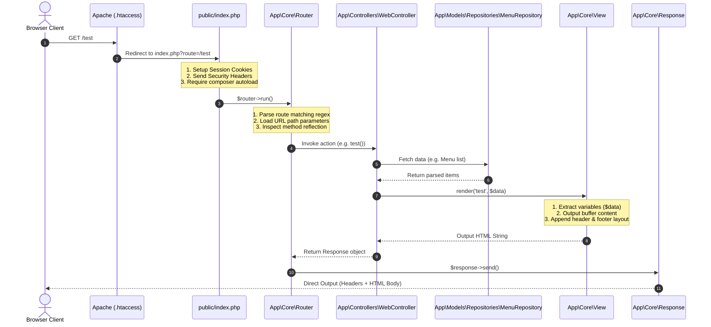

# ConscribePHP Architecture & Directory Topology

This document details the file system structure, core MVC components, routing system, and request-response lifecycle of the ConscribePHP framework.

---

## 📂 Directory Layout

The codebase layout separates static client-facing files from back-end logic, and isolates custom engine components from standard templates.

```
conscribe-php/
├── .htaccess                           # Root rewrite rules; redirects all traffic to public/
├── Dockerfile                          # Docker configuration for PHP 8.4 and Apache extensions
├── docker-compose.yml                  # Core docker-compose config
├── docker-compose_db.yml               # Compose file configured for linking to DB container
├── composer.json                       # PSR-4 Autoload mappings and requirements
├── docs/                               # Developer manuals and audits
│   ├── ROADMAP.md                      # Versioning rules, status and all framework tasks
│   ├── tasks.html                      # Clickable checklist of the roadmap
│   ├── website-checklist.md            # Checklist for client websites built on Conscribe
│   ├── NAVOD.md                        # Czech user guide
│   └── archive/audit-1.x.md            # Archived 1.x security audit
├── public/                             # Client-facing web root
│   ├── .htaccess                       # Strips trailing slashes, sets asset cache, rewrites to index.php
│   ├── index.php                       # Front controller entry point & bootstrap environment
│   ├── css/                            # Stylesheets
│   ├── js/                             # Client-side scripts
│   ├── img/                            # Images & SVG assets
│   ├── robots.txt                      # Crawler search settings
│   └── sitemap.xml                     # XML Search Index
└── app/                                # Backend MVC files
    ├── Config/                         # Configurations (routes.php, main.example.php)
    ├── Core/                           # MVC core engines (Router, Request, Response, Controller, View)
    ├── Helpers/                        # Global template utility helpers (TemplateHelper.php)
    ├── Controllers/                    # HTTP action controllers (WebController.php)
    ├── Models/                         # Database and business logic models (BaseModel.php)
    │   └── Repositories/               # Custom repositories (MenuRepository.php)
    ├── Modules/                        # Modular integrations (LanguageMutations, ContactSender)
    └── Views/                          # View PHP scripts
        ├── layout/                     # Wrap layouts (header.php, footer.php)
        └── pages/                      # Page templates
```

---

## 🔄 The Request Lifecycle

Every HTTP request traverses a linear path through ConscribePHP's custom MVC flow:



---

## 🧱 Core MVC Engine Breakdown

ConscribePHP uses several custom classes to run the MVC runtime. These live under the [app/Core/](file:///home/mbrotys/Web/projects/03_osobní/conscribe-php/app/Core/) directory.

### 1. Routing Engine ([Router.php](file:///home/mbrotys/Web/projects/03_osobní/conscribe-php/app/Core/Router.php))
- **Registration**: Routes are registered via `$router->get($path, $action)` or `$router->post($path, $action)` in [app/Config/routes.php](file:///home/mbrotys/Web/projects/03_osobní/conscribe-php/app/Config/routes.php).
- **Variable Matching**: Paths with curly braces (e.g., `clanek/{slug}`) are translated into regex expressions: `clanek/(?P<slug>[^/]+)`.
- **Reflection Injection**: `Router::execute()` inspects the parameters of the matched controller method using PHP's `ReflectionMethod` API. It automatically injects the active [Request](file:///home/mbrotys/Web/projects/03_osobní/conscribe-php/app/Core/Request.php) object and matches named parameters to route slugs.

### 2. HTTP Request & Response wrappers
- **Request** ([Request.php](file:///home/mbrotys/Web/projects/03_osobní/conscribe-php/app/Core/Request.php)): Sanitizes inputs from `$_GET`, `$_POST`, `$_SERVER`, and `$_COOKIE`. Automatically decodes raw JSON bodies if the content type header indicates JSON.
- **Response** ([Response.php](file:///home/mbrotys/Web/projects/03_osobní/conscribe-php/app/Core/Response.php)): Buffers output contents, sets HTTP response headers, redirects (`Response::redirect($url)`), or returns REST structures (`Response::json($data)`).

### 3. Views & Layout Compositor ([View.php](file:///home/mbrotys/Web/projects/03_osobní/conscribe-php/app/Core/View.php))
- Uses a **Two-Step View** layout pattern.
- In `View::render()`, variables passed in the controller array are unpacked via PHP's `extract()`.
- An output buffer (`ob_start()`) captures the raw page code (e.g., `Views/home.php`).
- If rendering the standard layout, the engine wraps this content block by including [app/Views/layout/header.php](file:///home/mbrotys/Web/projects/03_osobní/conscribe-php/app/Views/layout/header.php) first, and [app/Views/layout/footer.php](file:///home/mbrotys/Web/projects/03_osobní/conscribe-php/app/Views/layout/footer.php) at the end.

### 4. Database Singleton Wrapper ([BaseModel.php](file:///home/mbrotys/Web/projects/03_osobní/conscribe-php/app/Models/BaseModel.php))
- Implements a static PDO instance: `self::$db`.
- Lazy-initializes the connection during first instantiation, querying database configurations.
- Configures default PDO attributes to throw exceptions (`PDO::ERRMODE_EXCEPTION`) and fetch results as associative arrays (`PDO::FETCH_ASSOC`).

### 5. Repository Pattern ([MenuRepository.php](file:///home/mbrotys/Web/projects/03_osobní/conscribe-php/app/Models/Repositories/MenuRepository.php))
- Decouples raw menu database/source loading from views.
- Automatically calculates highlight settings (`$item->active = true`) by matching current URL segments with menu links, updating parent nodes dynamically.
